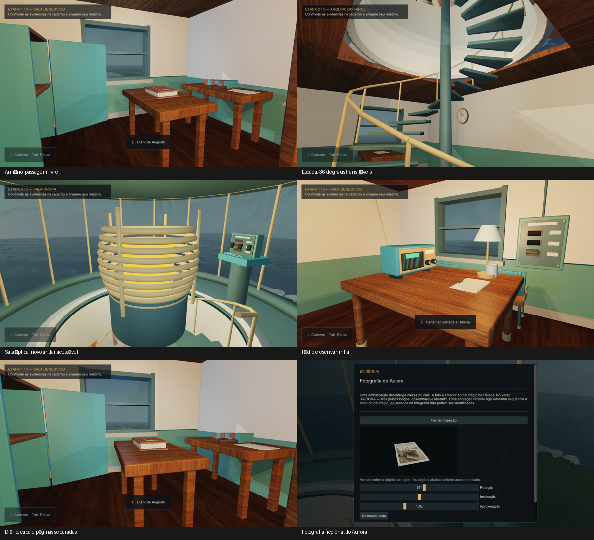

# O Último Sinal

Jogo de investigação em C++/OpenGL para Projeto Integrador e Computação Gráfica. Revisão atual: **22/10/2026**. A base do professor e as cenas 0, 1, 5 e 6 foram preservadas; o jogo ocupa a cena 2.

Abra **Jogar.cmd**, na raiz da pasta O Último Sinal. O Release instalado usa os modelos atualizados. O HUD mostra ETAPA 1/3 na sala de serviço, 2/3 no arquivo e 3/3 na sala óptica, acessível pela escada em espiral com 36 degraus. São três áreas conectadas no mesmo cenário.

## Jogar e apresentar

WASD: andar; mouse: olhar; E: examinar; J: caderno; Esc/Tab: pausa/voltar; F1: ajuda gradual; F2: opções. No menu, Continuar preserva a investigação. Nova investigação pede confirmação quando há progresso.

Investigue a morte de Augusto e explique por que o farol emitiu um sinal após a notícia da queda. Compare documentos, vestígios e horários; resolva energia, rádio e o ensaio local da lente no alto da torre. Fundamente uma hipótese com evidências e justificativa. A qualidade do texto final é avaliada por uma pessoa, sem correção por IA.

O armário fica na sala de serviço. Recupere a energia para abri-lo e pegar a chave. Depois atravesse a porta do arquivo e use a escada. O caderno registra apenas o que foi descoberto. Quatro pistas oferecem inspeção 3D com rotação/inclinação/zoom. Volume, brilho, sensibilidade, inversão vertical, redução de movimentos e comandos estão nas opções.

O progresso fica em `%LOCALAPPDATA%/UltimoSinal/progress.v3`; opções em options.v1. Partidas antigas preservam as descobertas. Posições incompatíveis com a nova arquitetura são recolocadas em um ponto seguro. Os testes usam perfis isolados.

## Documentação atual

- [Procedimentos, código, apresentação e pendências de 22/10](docs/Revisao_cenario_22-10-2026.md).
- [Investigação, enigmas e inspeção de 21/10](docs/Revisao_profunda_21-10-2026.md).
- [Autoria e procedência dos recursos](docs/CREDITOS.md).
- [Requisitos](docs/REQUISITOS.md) e [validação](docs/VALIDACAO.md).

## Visual Studio e dependências

Abra BaseAppOGL/BaseAppOGL.sln no Visual Studio Community com desenvolvimento desktop em C++, toolset v145 e Windows SDK. O SDK do professor deve ficar em OpenGL_SDK ao lado de BaseAppOGL. Ele não é incluído no Git. Os scripts ConfigurarSDK.ps1, PrepararSDKDebug.ps1 e PrepararSDKRelease.ps1, em tools, documentam a configuração local das bibliotecas; é necessário usar o SDK do professor. Não misturar bibliotecas Debug e Release.

Compile Debug | x64 para depurar em BaseAppOGL/bin/Debug. Jogar.cmd abre BaseAppOGL/bin/InvestigacaoRelease/BaseAppOGL.exe. Os recursos são localizados pela posição do executável, independentemente da pasta de trabalho. A distribuição requer Windows x64, OpenGL 4.6 e Microsoft Visual C++ Runtime x64 compatível. Testar no computador da apresentação ainda é necessário.

Atalhos acadêmicos: Ctrl+0/1/5/6 abre aulas; Ctrl+2 recria o jogo; Ctrl+V alterna VSync. Números sem Ctrl não trocam cenas durante a exploração.

## Código e testes

Narrative.h contém a história; Investigation.h define as regras; UltimoSinal.cpp processa entradas, caminhada e interação; Spatial.h calcula o apoio da escada/andares; World.cpp desenha o cenário; Interface.cpp e Experience.cpp mostram telas/objetivos; Storage.h e Persistence.cpp salvam; Audio.cpp sintetiza o som; os shaders preservam as técnicas da base.

Execute tools/Testar.py com Python ou abra os quatro projetos de tests no Visual Studio. Resultados atuais: 3.446 verificações de lógica/1.632 estados, 46 de apresentação, 38 de áudio PCM e 185 de apoio espacial. Release e Debug passaram em 306 verificações de runtime cada, sem falhas; cinco cenas desenharam sem erro GL. Foram conferidos 38 quadros e 39 recursos nativos do cenário sem fallback, além da mesa. Logs em logs/spatial_2026-10-22.

## Modelos e distribuição

Cenario/cenario.max e Mesa/mesa.max são fontes editáveis. A produção foi assistida por MAXScript executado no 3ds Max 2027, sem alegação de modelagem manual integral. São 40 arquivos .3DS: quatro instâncias da mesa, uma escrivaninha nova e o conjunto do cenário. wood.jpg e photo.jpg foram geradas com a ferramenta de imagens integrada; P1.jpg da aula foi preservada. Apenas o piso possui CompleteMap nativo 1024×1024 em UV1.

Pacote jogável: dist/O-Ultimo-Sinal-Investigacao-v3.zip. Fontes do Max: dist/Cenario-3dsMax-Fontes.zip. Geradores: tools/Empacotar.py e tools/EmpacotarFontes.py. Versões anteriores ficam em backups e dist/backups.

Ainda faltam teste humano completo, audição em dispositivo real, avaliação em outros DPIs/computador e polimento artístico. O estado atual não declara a entrega acadêmica concluída. Os documentos datados mantêm os resultados históricos.
