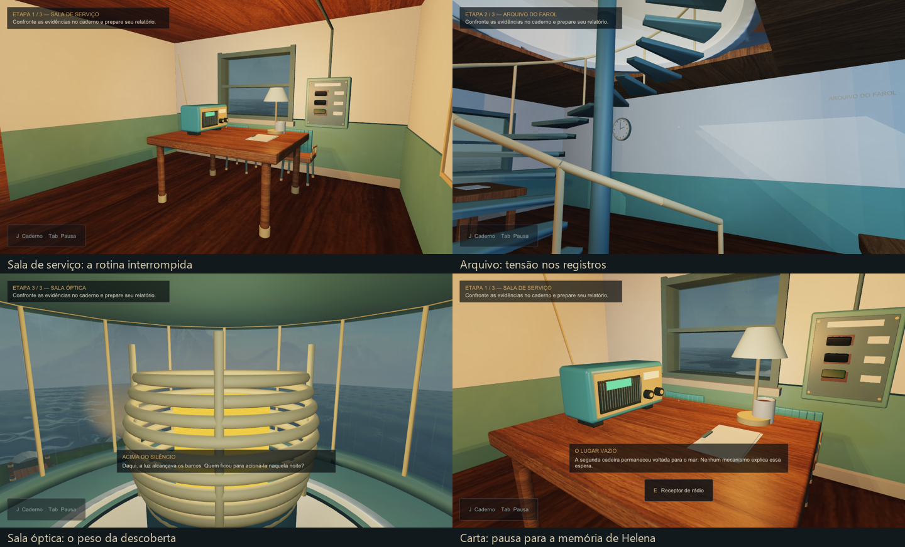

# Acabamento artístico e emocional — 8 de novembro de 2026

Esta é a primeira passagem de acabamento sobre as três áreas conectadas de O Último Sinal. A implementação modifica luz, resposta dos materiais, clima, acústica e momentos de reflexão. O percurso e os três enigmas continuam na base C++/OpenGL do professor.

## Intenção de cada área

| Área | Acabamento visual | Ritmo e emoção |
|---|---|---|
| Sala de serviço | Luz de mesa mais quente, contraste com a janela fria, madeira e pintura com desgaste discreto, umidade nos vidros. | Apresenta os hábitos interrompidos de Augusto. A descoberta do diário e da carta tem uma breve reflexão, depois que a leitura é fechada. |
| Arquivo do farol | Luz fria, sensação mais contida, variação de metal/pintura e feixe discreto junto à janela. | Os documentos e horários passam ao primeiro plano. A entrada da área e a fotografia têm textos próprios; o ambiente usa uma ressonância baixa e transição suave do exterior. |
| Sala óptica | Contraste entre o mar frio e o núcleo âmbar da lente; umidade nos vidros, partículas na altura da sala. Após confirmar o ensaio, a luz fica um pouco mais quente. | O vento ganha presença no alto e os passos adquirem resposta metálica na escada/galeria. A chegada e o fim do ensaio têm momentos específicos, preservando a pergunta sobre aquela noite. |

No exterior há chuva leve, sem partículas atravessando o anexo ou a torre. A água, o céu e as técnicas gráficas anteriores foram mantidos. A opção de redução de movimentos remove a chuva em queda e mantém os movimentos visuais congelados conforme o comportamento existente; a umidade do vidro permanece estática.

## Momentos de reflexão

Há apresentações das três áreas e respostas à primeira descoberta do diário, fotografia, carta, confirmação da lente e retorno à exploração após o relatório. Os textos não identificam um culpado novo nem criam registros históricos adicionais.

A legenda dura aproximadamente 7,5 segundos de exploração, com entrada/saída suave. Aguarda a leitura ou o enigma ser fechado e respeita a prioridade dos avisos de energia/chave/rádio já existentes. Ao mudar de área rapidamente, apresentações antigas daquela área são descartadas. O mesmo local não dispara a legenda em cada entrada durante uma sessão.

Nas reflexões, o volume do ambiente diminui gradualmente até 42% do seu nível normal e depois volta. Isso afeta a mistura de ambiente, não o controle de volume do jogador. Os efeitos de interação e os pulsos da lente ficam preservados. Não foram acrescentados vozes, passos de personagens invisíveis, novos códigos de rádio ou sustos com flashes.

As descobertas já presentes em um salvamento inicializam os eventos como conhecidos. Por isso, Continuar não repete o luto da carta ou uma descoberta já registrada. Não há novos campos no progress.v3; a primeira visita a uma área sem evidência persistente de visita pode reapresentar sua breve introdução em uma sessão futura. Os eventos são apresentação, sem alterar pré-requisitos, pistas, tempo da investigação ou hipótese final.

## Materiais e limites da técnica

O desgaste é um acabamento procedural no shader sobre as UVs e bitmaps já importados: umidade baixa na alvenaria, variação sutil da pintura, pátina no metal e resposta da madeira. Não é uma nova textura pintada manualmente, um conjunto PBR medido ou um bake produzido no Max.

Os feixes usam cartões transparentes com teste de profundidade; não constituem iluminação volumétrica com traçado de raios. A chuva usa partículas leves no exterior e alteração de normal/transparência nos vidros. A resposta metálica dos passos e os ambientes são sintetizados no áudio local.

Os 39 modelos do cenário, a mesa, suas texturas e masters do Max permanecem os da revisão de 22/10. O CompleteMap continua restrito ao piso. Sobre ele é aplicada a mesma graduação de cor da área; não foram recalculadas luzes ou sombras dentro desse bake. Nenhum novo arquivo .max ou .3DS foi produzido nesta passagem.

## Alterações no código

- **Atmosphere.h:** classificação física das áreas, fila de momentos, controle de repetição, pausa, retomada e transição de silêncio/luz. Não acessa arquivos de salvamento nem muda regras.
- **Experience.cpp:** integra o estado à exploração e desenha as legendas acima do aviso de interação. As informações essenciais continuam nos documentos e no caderno.
- **Audio.cpp / Audio.h:** recebem a área e o grau de reflexão; fazem transições de ambiente e material do passo em tempo de amostra PCM, com rampas suaves. Pausa preserva a posição dos efeitos de interação.
- **World.cpp:** fornece os parâmetros ao shader e desenha chuva e cartões de atmosfera. Os modelos, dimensões e colisões não foram reposicionados.
- **Prototype.frag:** acabamento dos materiais, graduação por sala, resposta da luz após a lente e gotas nos vidros.
- **RenderReview.cpp:** preserva o estado de apresentação e acrescenta sete enquadramentos. O conjunto passa a 45 imagens de conferência.

## Validação realizada

| Verificação | Resultado |
|---|---|
| Lógica e salvamento | 3.446 verificações; 1.632 estados alcançáveis. |
| Apresentação anterior | 46 verificações. |
| Áudio PCM | 44 verificações, incluindo transições por área, silêncio/mute e igualdade de todas as amostras do ensaio com/sem quietude emocional. |
| Escada e apoio | 185 verificações. |
| Atmosfera | 24 verificações: áreas, prioridade de legenda, leitura, pausa, retomada, eventos únicos e redução de movimentos. |
| Release e Debug | 306 verificações de runtime por configuração; zero falhas. |
| Release instalado no Jogar.cmd | 306 verificações; zero falhas. |
| Importação e cenas do professor | 39/39 recursos sem fallback, mesa aceita, cenas 0/1/5/6/2 sem erro GL. |
| Conferência visual | 45 quadros; desgaste e intensidade de feixe suavizados após a primeira leitura. |
| Janela normal do jogo | Continuar → examinar carta → guardar leitura → reflexão. Foi usado perfil isolado, sem tocar no progresso real. |

Os cinco projetos de testes podem ser abertos no Visual Studio ou executados por tools/Testar.py. Não é necessário modificar a política de execução do Windows. O teste de áudio foi feito sem abrir dispositivo; a audição humana ainda precisa ser realizada.

### Sanidade de desempenho

BENCHMARK framebuffer_nonuniform=1 first_and_last=checked
BENCHMARK complete=1 mode=offscreen-msaa4 warmup=2s sample=3s vsync=not_applicable resolution=1280x720 count=595 median_ms=5.1977 p95_ms=6.7245
GPU=NVIDIA GeForce RTX 3050 Laptop GPU/PCIe/SSE2 Driver=4.6.0 NVIDIA 610.74

Esta medição usa renderização interna em 1280 × 720, MSAA4, com 2 s de aquecimento e 3 s de amostra. Não inclui apresentação no monitor nem substitui uma coleta completa ou teste em outra máquina.

## Como conferir no jogo

Abra **Jogar.cmd**. Para ver os ambientes, basta continuar e visitar as três áreas. Os momentos de pistas já conhecidas não repetem em uma partida salva; para observar todos desde o início, use uma investigação nova quando desejar. A confirmação de nova investigação continua protegendo o progresso existente.

Para a apresentação, mostre o contraste entre sala de serviço e arquivo, a chuva pela janela e a sala óptica; depois examine a carta e retorne à exploração. Ajuste o volume ambiente nas opções para ouvi-la confortavelmente. Não há nova etapa obrigatória além dos enigmas já existentes.

## Próximas necessidades de acabamento

Esta passagem ainda requer avaliação subjetiva com jogadores: ritmo das legendas, intensidade dos ambientes e conforto de leitura em diferentes resoluções/DPIs. Continuam pendentes audição real, percurso humano completo, teste no computador de apresentação e possíveis detalhes adicionais de geometria/animação. Os testes técnicos não comprovam que a emoção pretendida foi percebida pelas pessoas.

Os backups anteriores e os logs em logs/art_2026-11-08 preservam o trabalho e os resultados. O pacote jogável foi atualizado separadamente dos fontes editáveis do Max. Não houve envio ao Git nem submissão acadêmica.
