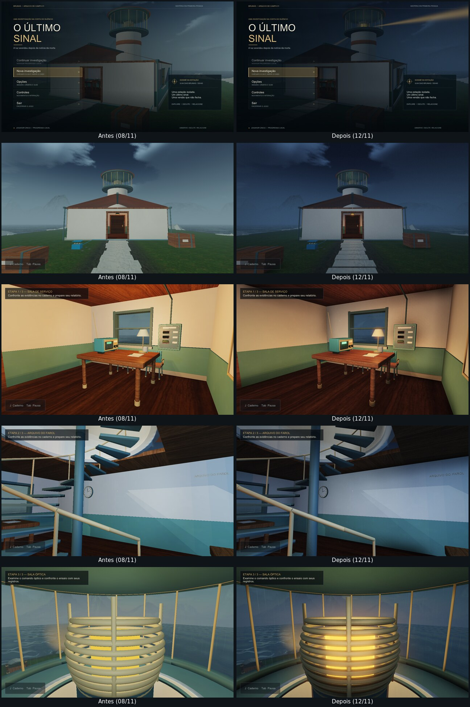

# Melhorias de 12/11/2026 — gráficos, jogabilidade e momentos das três áreas

**Estado desta revisão:** implementada e verificada em um build de conferência para Linux (Mesa llvmpipe, OpenGL por software), com os mesmos fontes, shaders e modelos. **Ainda não foi compilada no Visual Studio nem executada no Windows.** Antes de qualquer apresentação ou pacote, rode `Compilar.cmd` e jogue uma partida completa. O procedimento e o caminho de retorno estão no fim deste documento.

História, gabarito, textos de `Narrative.h`, regras de `Investigation.h`, formato de salvamento, modelos `.3DS`, mestres `.max`, bake do piso, pasta `Engine` e cenas de aula **não foram alterados**.

## Gráficos

| Mudança | O que é | O que não é |
|---|---|---|
| Alvo HDR e exibição única | A cena 2 é desenhada em ponto flutuante linear (com as 4 amostras de MSAA quando o driver aceita) e recebe uma só curva de exibição em `Post.frag`. | Não substitui nenhuma técnica da rubrica; todas continuam em `Prototype.frag`. |
| Oclusão de ambiente (SSAO) | Escurece cantos, encontros de parede e a base dos móveis a partir da profundidade da própria imagem. | Não é bake, shadow map nem traçado de raios. O `CompleteMap` do piso continua sendo o único bake. |
| Bloom | Lâmpadas, núcleo da lente e feixe passam do branco de exibição apenas no alvo HDR e ganham halo. | Não é fonte de luz nova. |
| Clima de 05h40 | Céu, neblina e luz ambiente mais escuros e frios; a luz quente das salas contrasta com o exterior. | Os cubemaps e texturas da aula são os mesmos; só a gradação mudou. |
| Luminárias com cúpula | As duas Point de teto e a de mesa iluminam principalmente para baixo; tetos e alto das paredes caem para a sombra. | A quantidade de luzes Point não mudou. |
| Lanterna (Spot) | Cone externo suave com núcleo mais fechado: lê-se como feixe na parede. Desligada nas câmeras do menu e do prólogo. | — |
| Feixe do farol | Segundo braço oposto e halo no núcleo. Na tela de título, antes de existir uma sessão, a lente aparece acesa como capa. | A capa não é estado da investigação. |
| Gradação por área | Sombras e altas luzes com tinta própria na costa, serviço, arquivo, escada e sala óptica; vinheta e grão fino. | Tratamento de cor, sem alegação de nova iluminação. |
| Chuva | Mais riscos no exterior nas qualidades Média e Alta. | Redução de movimentos continua removendo a chuva em queda. |

**Qualidade Baixa** desenha a cena diretamente, sem alvo HDR, SSAO ou bloom. Se o shader de pós-processamento não compilar ou o driver recusar o alvo, `PostFx.cpp` desliga os passes pela sessão e a cena segue no desenho direto; o jogo não fecha por isso.

O piso com bake recebe apenas um fator de exposição coerente com a sala (energia ligada ou não). Nenhuma luz Point/Spot é somada ao atlas.

## Painel de técnicas (F3)

`F3` abre um painel que liga e desliga, na própria cena 2: multitextura, normal mapping, luzes Point, luz Spot, environment mapping (reflexão e refração), fog, pós-processamento HDR, SSAO e bloom. O mouse fica livre enquanto o painel está aberto; `F3` de novo devolve o mouse à câmera. Nada é salvo. Serve para a comparação "com e sem" pedida em `docs/REQUISITOS.md`. Skybox, blending de água/vidro e o bake do piso ficam sempre ativos.

## Jogabilidade

- **Movimento com aceleração:** a velocidade parte de zero e chega a 2,6 m/s em cerca de um quarto de segundo; ao soltar a tecla, o jogador para em menos de 30 cm. As regras de colisão e de apoio na escada (`Walk`, `Spatial.h`) são as mesmas.
- **Correr:** `Shift` leva a 3,7 m/s no chão. Na escada o jogador anda a 2,2 m/s e não corre.
- **Escada sem solavanco:** a altura *desenhada* da câmera desliza sobre cada degrau de 20 cm. A posição lógica (colisão, mira, salvamento) continua exata.
- **Balanço ao andar:** 1,4 cm, na cadência dos passos do áudio. Desligado por "Reduzir movimentos".
- **Clique esquerdo examina**, como a tecla de interação. Um clique que fecha um documento não é lido de novo como "examinar".
- **Mira reativa:** o ponto abre em anel quando há algo ao alcance, e o objeto recebe um realce quente. O realce não é aplicado ao atlas do piso.
- **Contato com parede:** a componente bloqueada é absorvida, sem "empurrar" a parede ao soltar.

## Momentos das três áreas

Todos são apresentação: não criam pista, não abrem mecanismo, não mudam resposta e não são salvos (`Drama.h`).

| Momento | Onde | Comportamento |
|---|---|---|
| Tempestade que se afasta | Toda a ilha | Relâmpagos difusos no céu com trovão atrasado. Mais próximos antes da energia; raros depois do ensaio; nenhum depois do relatório. Pelo menos 16 s de exploração entre descargas automáticas. |
| Prólogo | Chegada | Uma descarga aos 3,2 s, na troca de frase. |
| Retorno da energia | Sala de serviço | As lâmpadas falham três vezes e firmam, ao voltar do painel. Continuar um salvamento não repete. |
| Fotografia do Aurora | Arquivo | A primeira leitura é respondida por uma descarga. |
| Chegada à sala óptica | Topo da escada | Uma descarga na primeira vez em que a vista se abre. |
| Ensaio da lente | Sala óptica | Os três pulsos longos enchem a própria sala de âmbar, no tempo do som e da lâmpada do console. O reforço é limitado ao volume da sala: nenhum feixe novo vai ao mar. |
| Depois do relatório | Toda a ilha | O céu abre aos poucos, a neblina cede, a chuva para e o sol baixo aquece a costa. Um salvamento concluído já reabre assim. |

**Acessibilidade:** "Reduzir movimentos" remove todos os clarões, a falha das lâmpadas e a pulsação do ensaio (fica um brilho fixo e baixo). O trovão continua audível. Cada descarga tem no máximo dois picos em 0,62 s, e uma descarga pedida por um momento da história é recusada se outra ocorreu há menos de 4 s.

## Como foi verificado

Build de conferência: g++ 13 e clang 18 sobre os fontes de `Scenes/UltimoSinal` e `Engine`, com cabeçalhos substitutos para as poucas chamadas de Windows (áudio sem dispositivo) e as mesmas macros de `windows.h` que costumam colidir no MSVC (`near`, `far`, `min`, `max`). Renderização em Mesa llvmpipe 25.2, janela virtual 1280 × 720, MSAA 4. Esse build de conferência fica fora do projeto e não foi gravado nesta pasta.

| Verificação | Versão de 08/11 no mesmo ambiente | Esta revisão |
|---|---|---|
| `VerifyRuntime` (o mesmo de `--verify-game`) | 306 aprovadas, 0 falhas | 306 aprovadas, 0 falhas |
| Modelos do Max aceitos sem fallback | 39 + mesa | 39 + mesa |
| Quadros do `RenderReview` sem erro OpenGL | 45 | 52 (os 45 anteriores e 7 novos) |
| Lógica / estados | 3.446 / 1.632 | 3.446 / 1.632 |
| Apresentação, espacial, atmosfera | 46, 185, 24 | 46, 185, 24 |
| Áudio PCM | 44 | 46 (inclui o trovão) |
| Momentos (`DramaTests`, novo) | — | 46 |
| Shaders no validador de referência (glslang) | — | 6 arquivos sem erro |
| Percurso simulado pelo caminho real de entrada | — | 18 de 18 |

O percurso simulado segura teclas pelo `InputManager` a 60 Hz e mede: partida suave (12 cm no primeiro décimo de segundo), cruzeiro de 2,60 m/s, parada em 14 cm, corrida de 3,70 m/s, porta trancada detendo o jogador correndo, deslizamento em parede, subida e descida dos 36 degraus, ausência de corrida na escada, maior salto da câmera desenhada de 4,7 cm por quadro e as três regras do clique.

**Limites desta verificação.** Ela não substitui o MSVC: uma construção aceita por g++ e clang ainda pode ser recusada pelo compilador da Microsoft. O renderizador por software não reproduz driver de GPU nem desempenho; nenhuma medição de tempo de quadro foi feita. O áudio foi conferido só como PCM, sem audição. Nenhuma pessoa jogou esta revisão.

## Compilar e conferir no Windows

1. Dê dois cliques em **`Compilar.cmd`**, na raiz. Ele compila Release e Debug x64, roda os seis conjuntos de teste e o `--verify-game` das duas configurações. Os logs ficam em `logs/melhorias_2026-11-12`. O script é novo e também não foi executado no Windows; se ele falhar por si, compile pela solução (`BaseAppOGL/BaseAppOGL.sln`, Release | x64) e rode `python tools/Testar.py`.
2. Se o compilador apontar erro, anote arquivo, linha e mensagem. Os arquivos novos são `PostFx.cpp` e `Drama.h`.
3. Abra `Jogar.cmd` e faça uma partida do zero. Confira em especial: tela de título, chegada, lanterna nas paredes, retorno da energia, escada, ensaio da lente, relatório e o céu depois dele. Teste `F3`, `Shift`, clique esquerdo, "Reduzir movimentos" e as três qualidades.
4. Rode `--benchmark` no Release: o custo do pós-processamento ainda não foi medido na RTX 3050 nem no computador da apresentação.
5. Só depois gere o pacote com `tools/Empacotar.py`. Os novos `Post.vert` e `Post.frag` entram pela regra de extensões que o script já usa.

**Se a imagem ficar escura no projetor:** suba "Brilho" nas opções (F2). **Se algo visual estiver errado:** a qualidade "Baixa" ou o item "Pós-processamento HDR" do painel F3 voltam ao desenho direto.

## Desfazer

Os arquivos de 08/11 que esta revisão alterou estão em `backups/pre_melhorias_2026-11-12`, na mesma estrutura de pastas. Para voltar, copie essa pasta sobre a raiz e apague os arquivos novos listados abaixo. Os executáveis em `bin` e os pacotes em `dist` não foram tocados. Atenção a um detalhe: o executável lê os shaders da pasta `Scenes` ao abrir. Por isso, até uma nova compilação, `Jogar.cmd` abre o programa de 08/11 **já com os shaders novos**: o clima mais escuro, as luminárias com cúpula e a lanterna aparecem, mas sem pós-processamento, movimento novo, painel F3 ou momentos. Essa combinação foi conferida no build de Linux (desenha sem erro OpenGL); o pacote em `dist` tem a própria cópia dos shaders e não muda.

## Arquivos

**Novos:** `BaseAppOGL/Scenes/UltimoSinal/PostFx.cpp`, `Drama.h`, `Post.vert`, `Post.frag`; `tests/DramaTests.cpp`, `tests/DramaTests.vcxproj`; `tools/CompilarEVerificar.ps1`; `Compilar.cmd`; este documento e `docs/evidencias_2026-11-12`.

**Alterados:** em `Scenes/UltimoSinal`: `UltimoSinal.h`, `UltimoSinal.cpp`, `World.cpp`, `Interface.cpp`, `Experience.cpp`, `RenderReview.cpp`, `Audio.cpp`, `Audio.h`, `Prototype.frag`, `Sky.frag`. Também `BaseAppOGL.vcxproj` e `.filters` (quatro itens novos), `tests/AudioPcmTests.cpp` (cue 6), `tools/Testar.py` e `tools/Testar.ps1` (sexto conjunto), `README.md`, `docs/STATUS.md` e `docs/CREDITOS.md`.

**Intocados:** `Engine`, cenas 0, 1, 5 e 6, `Narrative.h`, `Investigation.h`, `Storage.h`, `Persistence.cpp`, `Spatial.h`, `Geometry.h`, `Settings.h`, `Atmosphere.h`, `Experience.h`, `Inspection.*`, `RuntimeChecks.cpp`, modelos, texturas, `bin`, `dist`, `.git`.

## O que falta validar

- Compilação Debug e Release no MSVC v145 e `--verify-game` nas duas.
- Partida humana completa, com atenção a legibilidade das pistas no clima mais escuro e ao conforto do movimento.
- Desempenho com pós-processamento (`--benchmark`, três coletas) e teste em janela no computador da apresentação, incluindo GPU integrada se for o caso.
- Audição do trovão em dispositivo real.
- Piloto com participantes: nenhuma afirmação sobre emoção percebida ou clareza foi medida.
- Atualizar `docs/REQUISITOS.md` e o pacote em `dist` depois que a compilação no Windows for confirmada.

## Para a apresentação de Computação Gráfica

SSAO, bloom e gradação são acabamento em tela e devem ser apresentados assim. Para cada item da rubrica, abra o painel `F3`, desligue a técnica e mostre a mesma vista; para o bake, use a comparação já registrada em `Scenes/Models/Cenario/evidencias`. Os quadros `51_sem_pos_processamento` e `52_com_pos_processamento` mostram a mesma vista pelos dois caminhos.
