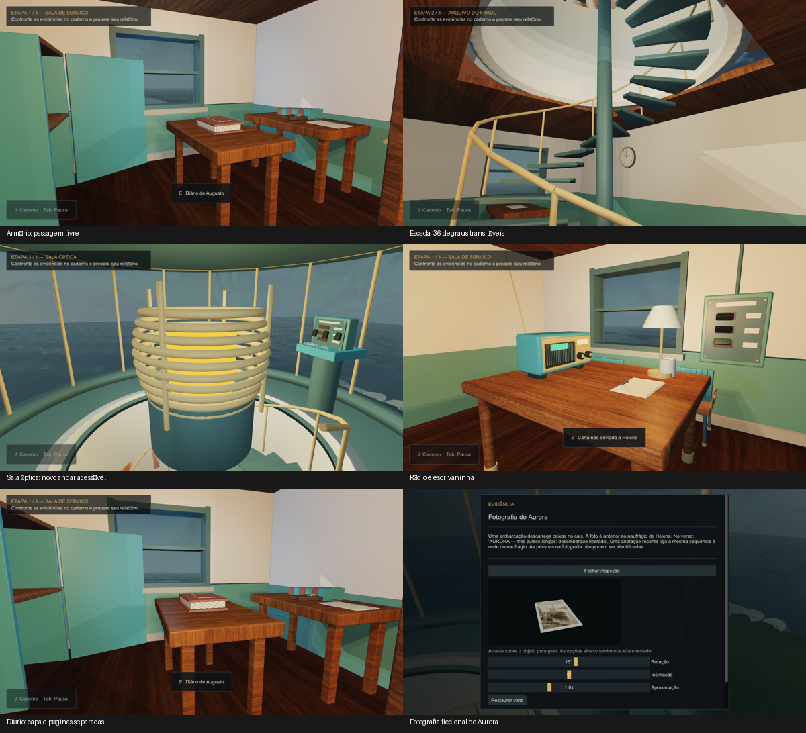

# Revisão do cenário — 22 de outubro de 2026

O Último Sinal passou por uma revisão de circulação, arquitetura e objetos dentro da base C++/OpenGL do professor. O objetivo foi corrigir a escada sem função, a passagem do armário, a repetição dos móveis e a ausência de um percurso vertical. O jogo continua em desenvolvimento.

## O que mudou

| Problema anterior | Implementação desta revisão |
|---|---|
| Escada decorativa encostada na parede | Escada em espiral com 36 degraus de 20 cm, duas voltas, corrimão e apoio real para o jogador. |
| Peças atravessavam o fechamento superior | Torre oca, abertura na cobertura, patamar e piso anular modelados para o percurso. A luminária saiu do eixo da escada. |
| Mesa ocupava o acesso ao armário | Mesa do diário e bancada de manutenção reposicionadas, com passagem para abrir o armário e recolher a chave. |
| Mesmo espaço para toda a investigação | Três áreas conectadas: sala de serviço, arquivo e sala óptica no alto da torre. O HUD identifica ETAPA 1/3, 2/3 e 3/3. |
| Rádio e móveis pouco reconhecíveis | Rádio com grade, mostrador e botões; escrivaninha com gavetas e puxadores; cadeira com encosto curvo e peças arredondadas. |
| Diário parecia uma caixa de madeira | Capas de couro, lombada e bloco de páginas separados. |
| Fotografia sem imagem legível | Imagem ficcional do navio Aurora, aplicada por UV explícito, com verso de papel. |
| Madeira grosseira e repetitiva | Textura de veios finos e novo bake do piso, conforme o novo posicionamento de móveis/luzes. |

São três áreas do mesmo cenário conectado. Ainda não existem três mapas independentes com carregamento separado ou campanhas adicionais. A investigação preserva os três enigmas: energia, rádio e reconstituição local da lente.

## Como apresentar o percurso

1. Abra `Jogar.cmd`, na pasta O Último Sinal da Área de Trabalho. A tela de exploração mostra **ETAPA 1 / 3 — SALA DE SERVIÇO** na área inicial.
2. Entre pelo caminho do cais. Examine documentos e vestígios com E; consulte o caderno com J. WASD movimenta e o mouse controla o olhar.
3. Relacione a manutenção ao circuito, recupere a energia, abra o armário e recolha a chave. A mesa do diário fica ao lado da área de acesso ao armário.
4. Abra a porta do arquivo. Compare os registros e use a carta de navegação na sintonia do rádio. As informações recebidas ficam transcritas no caderno.
5. No arquivo, aproxime-se do primeiro degrau da escada em espiral. Siga os degraus com WASD, contornando o eixo central durante duas voltas. Não há comando de pulo nem teletransporte.
6. Ao chegar ao patamar superior, siga pelo piso em volta da lente. O comando óptico fica no pedestal junto ao vidro, afastado da saída da escada. Examine-o fisicamente com E.
7. Confronte a configuração do ensaio com a fotografia e os registros. O ensaio é local e não envia um novo sinal ao mar. Depois fundamente uma hipótese no relatório usando pelo menos duas evidências e justificativa.
8. Demonstre o menu, as opções de sensibilidade, o caderno, a inspeção 3D das pistas, o salvamento e a possibilidade de voltar pela escada.

Em uma apresentação sem spoilers, interrompa antes da solução do console e da hipótese final. O guia da revisão anterior explica a narrativa e os mecanismos em mais detalhe: [Revisão da investigação](Revisao_profunda_21-10-2026.md).

## Procedimento de produção no 3ds Max

Foi usada a instalação nativa do **3ds Max 2027**, com produção assistida por MAXScript gerado com o Codex. Os scripts foram executados dentro do aplicativo; não são arquivos .3DS fabricados fora do Max. Esse processo não representa modelagem manual integral do aluno.

O fluxo foi: revisar a implantação → criar geometria → conferir unidades/eixos → produzir Unwrap UVW → aplicar Standard/Bitmap → salvar o master .max → exportar os grupos selecionados em .3DS → importar pelo CAsset → conferir geometria, texturas, dimensões e circulação no jogo. A convenção do jogo é metro, com Y para cima; a conversão para o Max é `[x,y,z] → [x,-z,y]`.

Foram produzidos ou substituídos **14 exports**: anexo, torre, escada, vidro da torre, escrivaninha, rádio, diário, alicate, armário, porta do armário, decoração, cadeira, fotografia e piso. O conjunto final possui **39 arquivos .3DS do cenário mais a mesa**, totalizando 40 arquivos de modelos. Quatro móveis usam Mesa/mesa.3ds; a bancada do rádio usa o novo escrivan.3ds.

O master atual fica em `BaseAppOGL/Scenes/Models/Cenario/cenario.max`. Versões anteriores dos grupos permanecem ocultas, com renderização e sombras desabilitadas, sob nomes OLD_US_. Isso permite consulta sem duplicar os objetos no jogo. A mesa original editável permanece em `Models/Mesa/mesa.max`.

Escada, torre, anexo, vidro e decoração usam coordenadas de mundo e entram com matriz identidade. Recentrar esses modelos individualmente faria a arquitetura perder o alinhamento. Os objetos locais usam dimensões e posicionamentos definidos em World.cpp. A colisão usa volumes explícitos por objeto/altura; não se usa a caixa inteira de uma torre como parede invisível.

### Texturas e bake

`wood.jpg` e `photo.jpg` são imagens geradas com a ferramenta de imagens integrada do Codex. A fotografia é ficcional e não representa um registro histórico real. Os prompts estão em `Cenario/evidencias/spatial_2026-10-22/wood_prompt.txt` e `aurora_prompt.txt`. A antiga textura P1.jpg da aula foi preservada em Scenes/Textures e no backup. As demais procedências estão em [CREDITOS.md](CREDITOS.md).

O **piso** recebeu um novo CompleteMap 1024 × 1024 em UV1, com Render To Texture/Default Scanline do Max, usando o novo layout e a luminária deslocada. A comparação entre sombras ligadas e desligadas alterou **322.424 pixels** acima de 12 níveis RGB. O registro técnico e os hashes estão em `Cenario/evidencias/bake_verificacao.json`.

Esse bake cobre somente o piso. O shader 13 lê o mapa sem duplicar as luzes Point/Spot. Os outros objetos continuam com luz e sombras analíticas do jogo. Não foi produzido bake para todos os objetos. A mudança de textura, sozinha, não constitui bake de iluminação.

## O que acontece no código

| Arquivo | Responsabilidade e alteração |
|---|---|
| `Spatial.h` | Calcula a superfície de apoio do jogador por posição e altura anterior. Distingue as duas voltas da escada, apoia no patamar e recusa posições sem piso. Identifica as três áreas. |
| `UltimoSinal.cpp` | Processa entradas e interações. Walk aplica o apoio a cada pequeno movimento; Blocked considera altura para não criar paredes infinitas. O comando da lente só abre quando o jogador está fisicamente no andar superior. |
| `World.cpp` | Carrega os 39 exports, posiciona a arquitetura e os móveis, desenha a nova escrivaninha e ajusta volumes/luzes. A porta e o armário mantêm animação e estado próprios. |
| `Prototype.frag` | Preserva as técnicas da base, com luz ambiente fria, iluminação quente dos equipamentos e exposição interior ajustada. A luz do arquivo acompanha a posição física da luminária. |
| `Experience.cpp` | Mostra ETAPA 1/3, 2/3 ou 3/3 conforme a posição real. Ao completar os requisitos, o objetivo orienta preparar o relatório. |
| `Interface.cpp` | Mantém leitura, caderno, opções, inspeção e enigmas. Relê o registro do comando sem permitir abrir o console remotamente do andar inferior. |
| `Storage.h` / `Persistence.cpp` | Validam as novas alturas ao salvar/carregar. Posições antigas incompatíveis são recolocadas em uma área segura, preservando a investigação. O formato progress.v3 continua válido. |
| `RuntimeChecks.cpp` | Executa o percurso físico, com colisão, enigmas, subida de 36 degraus, salvamento no alto e descida. |
| `RenderReview.cpp` | Exporta 38 quadros para conferência visual, incluindo os cinco novos enquadramentos desta revisão. |
| `tests/SpatialTests.cpp` | Verifica a aproximação contínua ao primeiro degrau, subida/descida, patamar, alturas inválidas e identificação de área. |

O apoio dos degraus não utiliza gravidade ou física de corpos rígidos: é uma solução de caminhada controlada com validação de altura. Isso evita trocar de volta da escada por coincidência das coordenadas X/Z e impede caminhar sobre o vazio. A câmera acompanha a altura do apoio, em vez de ser forçada ao antigo Y fixo.

## Validação desta revisão

| Verificação | Resultado |
|---|---|
| Lógica e persistência | 3.446 verificações; 1.632 estados alcançáveis. |
| Apresentação | 46 verificações. |
| Áudio PCM, sem abrir dispositivo | 38 verificações. |
| Suporte espacial | 185 verificações, com 36 degraus na subida e descida. |
| Runtime Release e Debug | 306 verificações em cada configuração; zero falhas. |
| Executável instalado no Jogar.cmd | 306 verificações; zero falhas. |
| Importação | 39 modelos do cenário aceitos; zero fallback; mesa aceita. |
| Cenas da base 0, 1, 5, 6 e jogo 2 | Carregamento e desenho sem erro OpenGL. |
| Conferência visual | 38 quadros do renderizador, com as imagens desta página. |

Os testes usam perfis isolados. O progresso real não foi utilizado como fixture nem apagado. Para repetir os testes puros, execute `tools/Testar.py` com Python ou abra os quatro projetos da pasta tests no Visual Studio. O executável aceita `--verify-game`. Os resultados ficam em `logs/spatial_2026-10-22`.

### Medição curta de desempenho

BENCHMARK framebuffer_nonuniform=1 first_and_last=checked
BENCHMARK complete=1 mode=offscreen-msaa4 warmup=2s sample=3s vsync=not_applicable resolution=1280x720 count=855 median_ms=2.9148 p95_ms=5.1958
GPU=NVIDIA GeForce RTX 3050 Laptop GPU/PCIe/SSE2 Driver=4.6.0 NVIDIA 610.74

O modo benchmark-smoke mede renderização interna em 1280 × 720 com MSAA4, com 2 segundos de aquecimento e 3 segundos de coleta. É uma amostra técnica curta, sem apresentação no monitor. Não é um teste completo de desempenho, nem prova de taxa de quadros na máquina da apresentação.

## Referência visual e limites

A referência fornecida foi [Room & Exits Escape Room Wicked Games — level 2](https://www.youtube.com/watch?v=Q-eZ4QR0ObA): organização dos móveis, objetos identificáveis, contraste entre luz fria da sala e luz quente de mesa, além de aproximações para enigmas. O vídeo foi observado como referência de composição; nenhuma arte ou modelo do vídeo foi copiado. A implementação permanece um cenário 3D na base do professor, com estilo próprio ainda em polimento.

Ainda faltam uma sessão humana completa sem ajuda, ajuste de acabamento conforme esse teste, avaliação do áudio em dispositivo real, controles em diferentes DPIs e teste no computador da apresentação. Também continuam desejáveis mais variação de superfícies, detalhes de desgaste, animações ambientais e revisão de enquadramentos. A revisão não equivale à declaração de que o jogo está profissionalmente finalizado ou de que a entrega acadêmica recebeu aprovação.

## Arquivos para entrega e segurança do trabalho

- `Jogar.cmd`: abre o Release instalado com os recursos atualizados.
- `dist/O-Ultimo-Sinal-Investigacao-v3.zip`: pacote jogável, com executável, DLLs, recursos e créditos.
- `dist/Cenario-3dsMax-Fontes.zip`: master .max, mesa editável, exports, mapas, scripts e evidências.
- `backups/antes_cenario_20261022_080431.zip`: fontes/modelos anteriores à revisão.
- `backups/executavel_antes_cenario_*`: executável anterior à instalação.
- `dist/backups`: distribuições anteriores preservadas.

Os procedimentos e testes ficam registrados separadamente das pendências. Não houve envio ao Git nem submissão aos professores nesta revisão.
